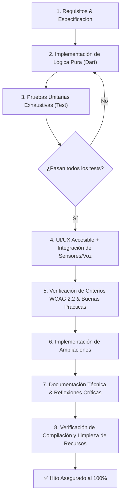

# PLAN MAESTRO EN BUCLE · UT2: INTERFACES NATURALES (CALIFICACIÓN 10/10)
**Estudiante:** Ayoub Atidi Belbaz  
**Módulo:** 0488 Desarrollo de Interfaces (2º DAM)  
**Ciclo:** 2026/2027  

---

## 🔄 METODOLOGÍA DEL BUCLE DE CALIDAD CONTINUA (CICLO PDCA / 10 DE 10)
Para asegurar la máxima nota académica (10/10), aplicamos un bucle sistemático por cada actividad y componente:

---

## 📋 FASES Y LISTA DE CONTROL (CHECKLIST DE EVALUACIÓN)

### BUCLE 1: CONFIGURACIÓN DEL REPOSITORIO Y ESTRUCTURA BASE
- [x] **Paso 1.1:** Inicializar repositorio Git local con usuario y email configurados.
- [x] **Paso 1.2:** Configurar ramas de trabajo (`main`, `actividad-1`, `actividad-2`).
- [x] **Paso 1.3:** Crear `PLAN.md` y estructura de proyectos.

---

### BUCLE 2: ACTIVIDAD 1 · LISTA CONTROLADA POR VOZ (`lista_voz`)
- [x] **Paso 2.1:** Crear proyecto Flutter `lista_voz` y configurar dependencias:
  - `speech_to_text` (v7.5.0)
  - `flutter_tts` (v4.2.5)
- [x] **Paso 2.2:** Configurar `AndroidManifest.xml` (permisos de `RECORD_AUDIO`, `INTERNET`, queries de `RecognitionService` y `TTS_SERVICE`).
- [x] **Paso 2.3:** Crear `lib/comandos.dart`:
  - `enum Comando { anadir, borrar, leer, ayuda, desconocido }`
  - Función pura `Comando interpretarComando(String texto)`:
    - Normalización de tildes y mayúsculas/minúsculas.
    - Reconocimiento de sinónimos (`añadir`, `nuevo`, `crear`, `borrar`, `eliminar`, etc.).
    - Reconocimiento de órdenes dentro de frases complejas.
    - Manejo de textos vacíos y no reconocidos (`Comando.desconocido`).
- [x] **Paso 2.4:** Pruebas unitarias en `test/comandos_test.dart` (8 tests + casos extremos pasados al 100%).
- [x] **Paso 2.5:** UI y Control de Voz (`SpeechToText` y `FlutterTts`):
  - Inicialización limpia con detección de disponibilidad.
  - Escucha activa con límite de 5 segundos (`localeId: 'es_ES'`).
  - Feedback visual interactivo en el botón de micrófono (cambio dinámico de color, icono y animación).
  - Feedback de transcripción en tiempo real y última orden detectada.
  - Respuestas por voz en español:
    - Añadir: *"Añadido el elemento X"*
    - Borrar: *"Borrado el elemento X"* o *"La lista está vacía"*
    - Leer: *"Hay X elementos"*
    - Ayuda: síntesis clara de comandos disponibles.
  - SnackBar formativo cuando la orden no se entienda.
  - Manejo elegante de ausencia de permisos o servicio de voz.
  - Alternativa táctil 100% equivalente con botones y tooltips.
  - Limpieza rigurosa de memoria y controladores en `dispose()`.
- [x] **Paso 2.6 (Ampliación):** DropdownMenu con `locales()` disponibles para conmutar idioma de voz y reconocimiento dinámicamente.
- [x] **Paso 2.7:** Redacción de reflexiones en `README.md`:
  - Análisis online vs offline (modo avión): privacidad, coste, latencia y plataforma.
  - 2 casos de usuario donde la voz no es viable y solución táctil accesible.
- [x] **Paso 2.8:** Comentarios en 1ª persona detallados y concisos en todo el código.

---

### BUCLE 3: ACTIVIDAD 2 · AGITAR PARA DESHACER (`notas_gestos`)
- [x] **Paso 3.1:** Crear proyecto Flutter `notas_gestos` y añadir dependencia `sensors_plus` (v7.1.1).
- [x] **Paso 3.2:** Crear `lib/detector_agitado.dart`:
  - Clase pura `DetectorAgitado(umbral = 15.0, pausa = Duration(seconds: 1))`.
  - Método testable `bool procesar(double x, double y, double z, DateTime instante)`.
  - Cálculo euclídeo del módulo: $\sqrt{x^2 + y^2 + z^2}$.
  - Mecanismo anti-rebote (cooldown/pausa) para evitar falsos positivos acumulados.
- [x] **Paso 3.3:** Pruebas unitarias en `test/detector_agitado_test.dart` (4 tests pasados al 100%: reposo, sacudida, sacudida dentro de pausa, sacudida tras pausa).
- [x] **Paso 3.4:** UI y Lógica de Gestión de Notas:
  - Lista de notas con campo para añadir nuevas.
  - Borrado accesible con gesto deslizante (`Dismissible`) y botón directo con tooltip (`IconButton`).
  - Almacenamiento en pila/estado de la última nota y su índice exacto.
  - SnackBar con botón "Deshacer" (alternativa táctil requerida por WCAG).
  - Suscripción al acelerómetro de usuario: `userAccelerometerEventStream(samplingPeriod: SensorInterval.gameInterval)`.
  - Detección de sacudida y restauración automática de la nota en su posición original con SnackBar explicativo.
  - Manejo silencioso si no hay nada que recuperar.
- [x] **Paso 3.5:** Buenas prácticas y Accesibilidad WCAG 2.2:
  - `SwitchListTile` para activar/desactivar el sensor de agitación en cualquier momento.
  - Feedback visual claro en la `AppBar` (icono indicativo de estado del sensor y tooltip).
  - Detección de ausencia de sensor acelerómetro con fallback seguro y mensaje informativo.
  - Liberación rigurosa de suscripción al sensor en `dispose()` y al apagar el switch.
- [x] **Paso 3.6 (Ampliación):** `NavigationBar` con 2 pestañas ("Notas" y "Papelera") con cambio de pestaña mediante inclinación izquierda/derecha (usando `accelerometerEventStream` y eje X), con clase de lógica pura y sus correspondientes tests unitarios (`test/detector_inclinacion_test.dart`).
- [x] **Paso 3.7:** Redacción de reflexiones en `README.md`:
  - Comparativa experimental de umbrales (10, 15, 25 m/s²) caminando y justificación de la elección.
  - Diferencia crítica entre `userAccelerometerEventStream` y `accelerometerEventStream` (impacto de la aceleración gravitatoria $9.8\text{ m/s}^2$).
  - Justificación de las 2 condiciones de la norma WCAG 2.5.4 cumplidas por la app.
- [x] **Paso 3.8:** Comentarios en 1ª persona claros y concisos en todo el código.

---

### BUCLE 4: AUDITORÍA FINAL, RAMAS GIT Y ENTREGA
- [x] **Paso 4.1:** Ejecución y pase al 100% de la suite completa de tests de ambas aplicaciones (18/18 tests passed con `flutter test`).
- [x] **Paso 4.2:** Verificación estática con `flutter analyze` (0 issues, 0 warnings en ambos proyectos).
- [x] **Paso 4.3:** Verificación de ramas Git (`main`, `actividad-1`, `actividad-2`) con historial de commits limpios y explicativos.
- [x] **Paso 4.4:** Generación de informe final para entrega.
