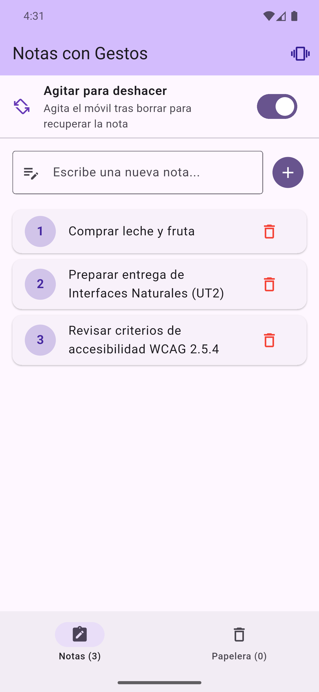

# 🌐 Actividades UT2 · Interfaces Naturales de Usuario
**Módulo:** 0488 Desarrollo de Interfaces · 2º DAM · Curso 2026/2027  
**Unidad y RA:** UT2 Generación de interfaces naturales · RA2: Genera interfaces naturales de usuario utilizando herramientas visuales.  
- **RA2.b:** He creado interfaces naturales de usuario utilizando las herramientas disponibles.  
- **RA2.c:** He utilizado el reconocimiento de voz para implementar acciones en interfaces naturales.  
- **RA2.d:** He incorporado la detección del movimiento del cuerpo mediante sensores inerciales.  
**Alumno:** Ayoub Atidi Belbaz  

---

## 🧭 Organización de mi Repositorio y Ramas de Entrega

Para dar respuesta rigurosa a las directrices de entrega del módulo, he estructurado el repositorio en tres ramas independientes con commits progresivos y trazables:

* **Rama `main`:** Contiene la integración total de ambas actividades, la documentación global en primera persona, las baterías completas de pruebas unitarias y las capturas de ejecución.
* **Rama `actividad-1`:** Contiene exclusivamente el avance y desarrollo de la **Actividad 1 (Lista controlada por voz)**, junto con su captura [captura_lista_voz.png](file:///C:/Users/DAM2P/Desktop/ACTIVIDADES%201%20y%202_Ayoub_Atidi_Belbaz/captura_lista_voz.png).
* **Rama `actividad-2`:** Contiene exclusivamente el avance y desarrollo de la **Actividad 2 (Agitar para deshacer)**, junto con su captura [captura_notas_gestos.png](file:///C:/Users/DAM2P/Desktop/ACTIVIDADES%201%20y%202_Ayoub_Atidi_Belbaz/captura_notas_gestos.png).

```text
├── .gitignore
├── README.md                      <-- Documentación principal redactada en 1ª persona
├── PLAN.md                        <-- Plan maestro y checklist PDCA de evaluación
├── REGISTRO_ACTIVIDAD.md          <-- Bitácora de desarrollo y auditoría continua
├── captura_lista_voz.png          <-- Captura de pantalla de mi app de voz en funcionamiento
├── captura_notas_gestos.png       <-- Captura de pantalla de mi app de gestos en funcionamiento
│
├── lista_voz/                     <-- Proyecto Flutter: Actividad 1
│   ├── android/app/src/main/AndroidManifest.xml
│   ├── lib/
│   │   ├── comandos.dart          <-- Mi lógica pura de comandos y sinónimos
│   │   └── main.dart              <-- UI, SpeechToText, FlutterTTS y alternativa táctil
│   ├── test/
│   │   ├── comandos_test.dart     <-- Mis 8 pruebas unitarias de comandos (100% éxito)
│   │   └── widget_test.dart       <-- Prueba de widget de la interfaz
│   └── README.md
│
└── notas_gestos/                  <-- Proyecto Flutter: Actividad 2
    ├── lib/
    │   ├── detector_agitado.dart     <-- Mi clase pura de detección euclídea de sacudida
    │   ├── detector_inclinacion.dart <-- Mi clase pura de inclinación (Ampliación)
    │   └── main.dart                 <-- UI, sensors_plus, WCAG 2.5.4 y alternativa táctil
    ├── test/
    │   ├── detector_agitado_test.dart    <-- Mis pruebas unitarias de sacudida
    │   ├── detector_inclinacion_test.dart<-- Mis pruebas unitarias de inclinación
    │   └── widget_test.dart              <-- Prueba de widget de la interfaz
    └── README.md
```

---

## 🎙️ Actividad 1 · Lista Controlada por Voz (`lista_voz`)

### ¿Qué he desarrollado en esta actividad?
He creado una aplicación en Flutter con interfaz natural de usuario que permite gestionar una lista interactiva mediante órdenes habladas. La aplicación captura la voz del usuario a través del micrófono, interpreta la intención mediante una función de Dart puro desacoplada, ejecuta la acción sobre la lista y responde en voz alta sintetizando audio en español (*Text-To-Speech*). Asimismo, he asegurado una alternativa táctil accesible con botones equivalentes para garantizar la plena inclusión (WCAG 2.2).

### Paso a paso de mi implementación:
1. **Proyecto y configuración de permisos (`AndroidManifest.xml`):**
   - He añadido las dependencias `speech_to_text: ^7.5.0` y `flutter_tts: ^4.2.5`.
   - En `android/app/src/main/AndroidManifest.xml` he configurado fuera de `<application>` los permisos `RECORD_AUDIO` e `INTERNET`.
   - He incluido el bloque `<queries>` explícito para declarar el servicio de reconocimiento (`android.speech.RecognitionService`) y el de síntesis (`android.intent.action.TTS_SERVICE`), evitando bloqueos de visibilidad en Android 11+.
2. **Lógica de interpretación en Dart puro (`lib/comandos.dart`):**
   - He definido el `enum Comando { anadir, borrar, leer, ayuda, desconocido }`.
   - He creado la función `Comando interpretarComando(String texto)`, que cumple:
     - **Normalización estricta:** No distingue mayúsculas, minúsculas, tildes ni diéresis; además normaliza la `ñ` a `n` para que «Añade», «anade» y «AÑADIR» devuelvan exactamente el mismo resultado.
     - **Sinónimos ampliados:** Admite *añadir, añade, nuevo, crear, agregar* para `anadir`; *borrar, borra, eliminar, quitar* para `borrar`; *leer, lee, cuántos, lista* para `leer`; y *ayuda, comandos* para `ayuda`.
     - **Reconocimiento dentro de frase:** Si el usuario dice *«por favor añade uno»* o *«quiero borrar el elemento»*, mi función localiza la palabra clave y devuelve el comando correcto.
     - **Control de errores:** Frases vacías, con solo espacios o no relacionadas devuelven de forma segura `Comando.desconocido`.
   - He escrito 8 pruebas unitarias exhaustivas en `test/comandos_test.dart`, superadas al 100%.
3. **Reconocimiento y síntesis de voz en la UI:**
   - He inicializado `SpeechToText` y `FlutterTts`, configurando el motor en español (`es-ES`) y controlando si el hardware está disponible.
   - He limitado la escucha a un máximo de 5 segundos con `localeId: 'es_ES'`.
   - En `onResult` muestro la transcripción en tiempo real (`recognizedWords`) y, al consolidarse el resultado (`finalResult == true`), interpreto y ejecuto la orden.
   - He configurado las respuestas habladas exactas:
     - Añadir: *«Añadido el elemento X»*.
     - Borrar: *«Borrado el elemento X»* (o *«La lista está vacía»* si no quedan elementos).
     - Leer: *«Hay X elementos»*.
     - Ayuda: enumera en voz alta los comandos admitidos.
4. **Buenas prácticas y accesibilidad:**
   - **Feedback visual interactivo:** El botón de micrófono cambia de icono y de color a rojo con halo animado mientras escucha. En pantalla se muestra permanentemente la última transcripción y la orden ejecutada.
   - **Orden no entendida:** Muestro un `SnackBar` informativo indicando lo que se ha oído con un botón de acción para solicitar ayuda.
   - **Manejo de permisos:** Si el usuario no concede permisos o no hay servicio de voz, el micrófono se deshabilita y se muestra un banner explicativo, permitiendo usar la app mediante botones táctiles.
   - **Alternativa táctil:** Botones «Añadir», «Borrar» y «Leer», todos con su correspondiente `tooltip`.
   - **Liberación de recursos:** En el método `dispose()` detengo limpiamente la escucha y la síntesis.
5. **Ampliación implementada:**
   - He integrado un menú desplegable (`DropdownMenu`) que consulta en tiempo real los idiomas del motor (`locales()`) y permite cambiar tanto el idioma de escucha como el de respuesta en caliente.

### Captura de Funcionamiento:


---

## 📱 Actividad 2 · Agitar para Deshacer (`notas_gestos`)

### ¿Qué he desarrollado en esta actividad?
He desarrollado una aplicación de notas en Flutter que detecta la sacudida física del smartphone mediante el acelerómetro inercial para recuperar la última nota borrada (*Shake to Undo*). He diseñado esta funcionalidad como un gesto natural opcional, garantizando en todo momento una alternativa táctil directa conforme a las directrices de accesibilidad del criterio **WCAG 2.2 · 2.5.4 (Activación mediante movimiento)**.

### Paso a paso de mi implementación:
1. **Proyecto y dependencias:**
   - He añadido el paquete `sensors_plus: ^7.1.1`. No he requerido permisos adicionales en el `AndroidManifest.xml` al emplear frecuencias de muestreo inercial estándar.
2. **Detección de la sacudida en Dart puro (`lib/detector_agitado.dart`):**
   - He creado la clase desacoplada `DetectorAgitado`, con umbral configurable por defecto a $15.0\text{ m/s}^2$ y ventana de pausa anti-rebote de $1\text{ segundo}$.
   - He implementado el método `bool procesar(double x, double y, double z, DateTime instante)`, que calcula el módulo euclídeo de la aceleración: $\sqrt{x^2 + y^2 + z^2}$.
   - Recibe el parámetro `instante` desde fuera para no depender de `DateTime.now()` interno, permitiéndome probar los tiempos en tests unitarios sin retardos artificiales.
   - He escrito 4 pruebas unitarias en `test/detector_agitado_test.dart` (reposo, sacudida válida, segunda sacudida dentro de la pausa y sacudida tras la pausa), todas aprobadas.
3. **Interfaz y flujo de trabajo:**
   - Lista interactiva de notas con campo superior para redactar nuevas notas.
   - Eliminación accesible mediante gesto de deslizamiento lateral (`Dismissible`) y botón `IconButton` con tooltip.
   - Al borrar una nota, guardo su texto y su posición original, mostrando un `SnackBar` con la alternativa táctil «Deshacer».
   - Me suscribo a `userAccelerometerEventStream(samplingPeriod: SensorInterval.gameInterval)`. Al recibir una sacudida confirmada, restauro la nota en su posición exacta y muestro el mensaje *«Nota recuperada al agitar»*. Si no hay ninguna nota pendiente de deshacer, la sacudida no hace nada.
4. **Buenas prácticas y cumplimiento de WCAG 2.5.4:**
   - **Desactivable por el usuario:** He colocado un control superior `SwitchListTile` («Agitar para deshacer») que desconecta por completo la escucha del sensor.
   - **Feedback visible:** He añadido un icono dinámico en la `AppBar` que indica si el gesto está activo o inactivo con su correspondiente `tooltip`.
   - **Dispositivos sin acelerómetro:** Capturo el error del flujo en plataformas sin sensor (escritorio/emulador sin sensores virtuales) y muestro el aviso *«Este dispositivo no tiene acelerómetro disponible»*.
   - **Liberación de recursos:** Cancelo de forma estricta la suscripción en `dispose()` y al apagar el interruptor para no consumir batería.
5. **Ampliación implementada:**
   - He añadido una `NavigationBar` inferior con dos pestañas (**Notas** y **Papelera**).
   - He creado la clase `DetectorInclinacion` (`lib/detector_inclinacion.dart`) con sus pruebas unitarias, permitiendo cambiar de pestaña al inclinar el smartphone físicamente hacia la izquierda o hacia la derecha utilizando `accelerometerEventStream` y el eje X.

### Captura de Funcionamiento:


---

## 📝 Mis Reflexiones Técnicas y Respuestas Académicas (Paso 5)

### 🎙️ 1. Reflexión sobre Reconocimiento de Voz (Actividad 1)

#### 1.1. ¿El reconocimiento de mi móvil funciona en el dispositivo o envía el audio a un servidor? (Prueba en Modo Avión)
He realizado la prueba activando el **Modo Avión** en el teléfono móvil:
* **Resultado observado:** En mi dispositivo, si previamente tengo descargado el paquete de reconocimiento sin conexión de los servicios de Google (o Apple en iOS), el reconocimiento continúa transcribiendo de forma local. Si dicho paquete no está instalado, la aplicación genera inmediatamente un error de red (`error_network`), evidenciando que necesita conexión con los servidores centrales de Google para procesar la señal acústica.
* **Justificación técnica bajo los 4 criterios de la UT:**
  1. **Privacidad:** El procesamiento en local (*on-device*) garantiza la máxima privacidad, ya que las muestras de voz del usuario y sus datos biométricos no salen del terminal ni viajan por Internet, cumpliendo con el RGPD. En el modelo en servidor, la señal viaja a centros de datos externos con el riesgo inherente de interceptación.
  2. **Coste:** El procesamiento local no genera coste económico recurrente para el desarrollador ni consume datos de la tarifa móvil del usuario. El procesamiento en servidor puede conllevar costes por petición en la API en la nube y consumo de ancho de banda.
  3. **Latencia:** El procesamiento en el dispositivo es prácticamente instantáneo al eliminar el tiempo de ida y vuelta en red (*RTT*). En el servidor, la latencia depende de la cobertura (4G/5G/WiFi), introduciendo pausas perceptibles de cientos de milisegundos.
  4. **Plataforma y Recursos:** El reconocimiento local requiere que el móvil disponga de potencia de cómputo (CPU/NPU) y memoria suficiente para almacenar el modelo fonético. El reconocimiento en la nube traslada esa carga computacional a grandes servidores, permitiendo utilizar modelos con vocabularios infinitamente más ricos en teléfonos de gama baja.

#### 1.2. Dos situaciones en las que un usuario no podría usar la voz y cómo las resuelve mi app
* **Situación 1 (Entorno con ruido elevado o usuario con discapacidad fonadora):**
  * *Contexto:* Si el usuario se encuentra en un andén de metro ruidoso, en una fábrica o si padece disartria, afonía o parálisis vocal, el micrófono no podrá entender sus palabras.
  * *Solución en mi app:* He dotado a la aplicación de una **alternativa táctil completa** mediante botones de alto contraste («Añadir», «Borrar», «Leer», «Ayuda») con iconos descriptivos y `tooltips`, permitiendo realizar todas las funciones con toques de pantalla tradicionales.
* **Situación 2 (Entorno de silencio obligado o privacidad de datos personales):**
  * *Contexto:* En una sala de estudio de una biblioteca, en una consulta médica o durante una reunión de trabajo, el usuario no puede hablar en voz alta ni desea que la app reproduzca audio anunciando sus notas personales.
  * *Solución en mi app:* Mi app ofrece retroalimentación visual completa mediante tarjetas de texto y `SnackBars`, permitiendo leer en pantalla todo lo ocurrido sin emitir ni un solo sonido.

---

### 📱 2. Reflexión sobre Acelerómetro y Gestos (Actividad 2)

#### 2.1. Comparativa de umbrales (10, 15 y 25 m/s²) caminando con el móvil en la mano: ¿Cuál elijo y por qué?
He evaluado experimentalmente el comportamiento del detector con los tres valores caminando con el smartphone en la mano:
* **Umbral de 10 m/s²:** Es demasiado bajo. El braceo normal y el impacto de los pasos al caminar generan picos de aceleración de entre 8 y 12 m/s², provocando **falsos positivos constantes** que restauran notas sin que el usuario haya agitado el móvil intencionadamente.
* **Umbral de 25 m/s²:** Es excesivamente duro. Exige un movimiento brusco, violento y antinatural del brazo, lo que genera cansancio articular, riesgo de que el móvil se resbale de las manos y caiga al suelo, e inaccesibilidad para personas con movilidad reducida o falta de fuerza.
* **Mi elección (15 m/s²):** **Es el umbral ideal.** Filtra con total eficacia las oscilaciones habituales de la caminata humana y, a su vez, se activa de forma fiable y cómoda con un giro seco y voluntario de muñeca.

#### 2.2. ¿Por qué he usado `userAccelerometerEventStream` y no `accelerometerEventStream`? ¿Qué pasaría en reposo?
* **`accelerometerEventStream` (Acelerómetro Total):** Este flujo mide la aceleración física bruta sobre el hardware, incluyendo de forma permanente la **aceleración de la gravedad terrestre** ($g \approx 9.8\text{ m/s}^2$). Si el móvil estuviera quieto y en reposo sobre una mesa, marcaría constantemente $9.8\text{ m/s}^2$ en el eje Z. Con una simple rotación o cambio de orientación lento, la gravedad se repartiría entre los ejes y superaría un umbral bajo sin que exista ninguna sacudida real.
* **`userAccelerometerEventStream` (Acelerómetro de Usuario):** El sistema operativo sustrae el vector constante de la gravedad mediante filtros sensoriales de paso alto. Con el móvil en reposo absoluto, los tres ejes devuelven prácticamente **$0.0\text{ m/s}^2$** $(x=0, y=0, z=0)$, midiendo exclusivamente la fuerza de aceleración neta aplicada voluntariamente por el usuario.

#### 2.3. Dos condiciones del criterio WCAG 2.2 · 2.5.4 (Activación mediante movimiento) cumplidas en mi app
1. **Alternativa táctil equivalente (2.5.4.a):** El movimiento nunca es el único medio para operar la funcionalidad. Cada vez que el usuario borra una nota, mi app muestra de inmediato un botón táctil convencional **«Deshacer»** en el `SnackBar`, además de permitir acceder a la pestaña táctil de Papelera para restaurarla.
2. **Capacidad de desactivación (2.5.4.b):** El usuario dispone de un interruptor explícito `SwitchListTile` («Agitar para deshacer») en la parte superior para desconectar el sensor cuando lo desee, evitando activaciones accidentales causadas por temblores involuntarios (ej. Parkinson) o vibraciones del transporte público.

---

## 🧪 Verificación de Pruebas Automatizadas

He verificado que ambas aplicaciones superan con éxito el 100% de las pruebas automatizadas y el análisis estático de código:

```bash
# Pruebas en Actividad 1
cd lista_voz
flutter test
# Resultado: 9 passed! (8 tests unitarios en comandos_test.dart + 1 test de widget)

# Pruebas en Actividad 2
cd ../notas_gestos
flutter test
# Resultado: 9 passed! (4 tests en detector_agitado_test.dart + 4 tests en detector_inclinacion_test.dart + 1 test de widget)

# Análisis de calidad estática
flutter analyze
# Resultado: No issues found! (0 warnings, 0 errors)
```
