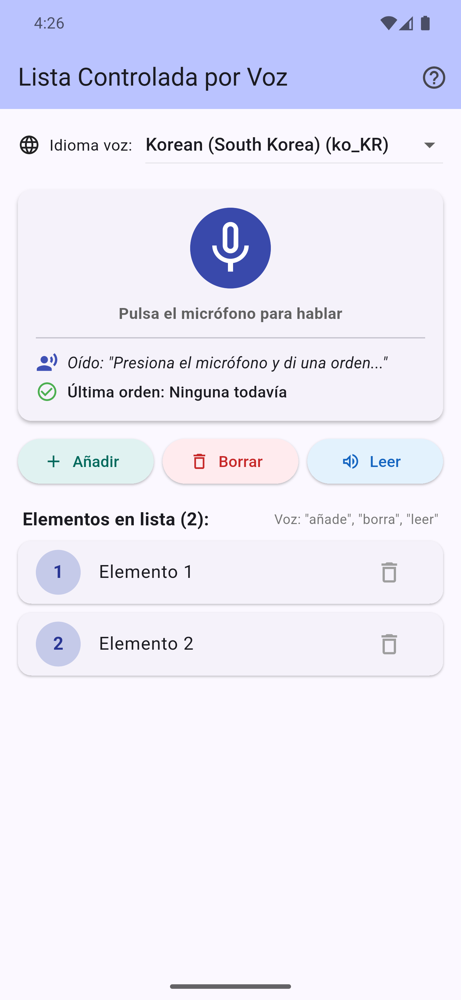

# 🎙️ Actividad 1 · Lista Controlada por Voz (`lista_voz`)
**Módulo:** 0488 Desarrollo de Interfaces · 2º DAM · Curso 2026/2027  
**Unidad y RA:** UT2 Generación de interfaces naturales · RA2: Genera interfaces naturales de usuario utilizando herramientas visuales.  
- **RA2.b:** He creado una interfaz natural de usuario utilizando las herramientas disponibles.  
- **RA2.c:** He utilizado el reconocimiento de voz para implementar acciones en interfaces naturales.  
**Alumno:** Ayoub Atidi Belbaz  

---

## 🎯 ¿Qué he desarrollado en esta actividad?
En esta actividad he desarrollado una aplicación interactiva en Flutter que permite gestionar una lista de elementos manejada mediante comandos de voz en lenguaje natural. El usuario pulsa el botón del micrófono, dice una orden y la app la ejecuta, dando respuesta auditiva hablada (*Text-To-Speech*). Asimismo, he garantizado que todas las acciones vocales dispongan de botones táctiles accesibles equivalentes, cumpliendo con las pautas de diseño para todos y accesibilidad WCAG 2.2.

---

## 📸 Captura de Funcionamiento en el Emulador / Móvil


---

## 🛠️ Tecnologías y Paquetes Utilizados
- **Flutter 3.x & Dart 3.x**
- **`speech_to_text: ^7.5.0`:** Para capturar el flujo de audio del micrófono y transcribir voz a texto en tiempo real.
- **`flutter_tts: ^4.2.5`:** Para sintetizar respuestas de voz auditivas en español (`es-ES`).
- **Permisos y Queries en AndroidManifest.xml:** He declarado los permisos `RECORD_AUDIO` e `INTERNET`, y el bloque `<queries>` explícito para `RecognitionService` y `TTS_SERVICE`.

---

## 🧠 Mi Implementación Paso a Paso

### Paso 1. Proyecto y permisos en Android
1. He creado el proyecto `lista_voz` e instalado las dependencias `speech_to_text` y `flutter_tts`.
2. En `android/app/src/main/AndroidManifest.xml` he añadido fuera de `<application>`:
```xml
<uses-permission android:name="android.permission.RECORD_AUDIO" />
<uses-permission android:name="android.permission.INTERNET" />
<queries>
  <intent>
    <action android:name="android.speech.RecognitionService" />
  </intent>
  <intent>
    <action android:name="android.intent.action.TTS_SERVICE" />
  </intent>
</queries>
```

### Paso 2. Interpretar las órdenes en Dart puro (`lib/comandos.dart`)
He desacoplado por completo la lógica de interpretación lingüística en un módulo de Dart puro sin dependencias de Flutter:
- **`enum Comando { anadir, borrar, leer, ayuda, desconocido }`**
- **Función pura `Comando interpretarComando(String texto)`:**
  - **Sin distinción de mayúsculas ni tildes:** Normalizo el texto eliminando acentos, diéresis y la virgulilla de la ñ (`ñ->n`), de manera que «Añade», «anade» y «AÑADIR» devuelven siempre `Comando.anadir`.
  - **Soporte de sinónimos ricos:**
    - Añadir: *añadir, añade, nuevo, crear, agregar, agrega*.
    - Borrar: *borrar, borra, eliminar, elimina, quitar, quita*.
    - Leer: *leer, lee, cuántos, cuantas, lista*.
    - Ayuda: *ayuda, comandos, comando*.
  - **Reconocimiento dentro de oraciones naturales:** Si el usuario dice *«por favor añade uno»* o *«quiero borrar el elemento»*, mi lógica localiza la intención y devuelve el comando correspondiente.
  - **Manejo de entradas vacías o no reconocidas:** Cadenas vacías o sin relación devuelven con total seguridad `Comando.desconocido`.

### Paso 3. Reconocimiento y síntesis de voz en la UI
En el `State` de la pantalla principal (`lib/main.dart`):
1. Creo e inicializo `SpeechToText` y `FlutterTts`, configurando el idioma en `es-ES` y verificando si el servicio está disponible en el hardware.
2. Al pulsar el micrófono, invoco `listen()` con `localeId: 'es_ES'` y limito la escucha a un máximo de 5 segundos.
3. En `onResult`, muestro en pantalla `recognizedWords` mientras el usuario habla y, cuando `finalResult` es `true`, interpreto la orden y la ejecuto.
4. **Respuestas habladas implementadas:**
   - Añadir: dice *«Añadido el elemento X»*.
   - Borrar: dice *«Borrado el elemento X»* (o *«La lista está vacía»* si no quedan elementos).
   - Leer: dice *«Hay X elementos»*.
   - Ayuda: enumera en voz alta la relación de órdenes disponibles.

### Paso 4. Interfaz y buenas prácticas accesibles
1. **Feedback visible:** El botón de micrófono cambia dinámicamente de icono y de color a rojo mientras escucha, acompañado de una tarjeta con la transcripción en vivo y la última orden ejecutada.
2. **Orden no entendida:** Muestro un `SnackBar` explicativo con lo que se ha oído y un botón directo para pedir ayuda (*«No he entendido "hola". Di "ayuda" para oír las órdenes»*).
3. **Sin permiso o sin servicio:** Si no hay servicio de voz o faltan permisos, el botón del micrófono se muestra deshabilitado junto a un banner de advertencia claro, garantizando que la app continúe funcionando con botones táctiles.
4. **Alternativa táctil:** Botones «Añadir», «Borrar» y «Leer» que replican exactamente las acciones de la voz, todos con sus respectivos `tooltips`.
5. **Liberación de recursos:** En el método `dispose()` detengo rigurosamente el motor de reconocimiento y el sintetizador.

### Paso 5. Ampliación implementada
He implementado un selector desplegable (`DropdownMenu`) que consulta en caliente los idiomas soportados por el dispositivo mediante `_speech.locales()`, permitiendo al usuario cambiar el idioma de reconocimiento y el de la síntesis de voz en tiempo real.

---

## 🧪 Pruebas Automatizadas (100% Pasadas)
He escrito 8 pruebas unitarias exhaustivas en `test/comandos_test.dart` y 1 prueba de widget en `test/widget_test.dart`:

```bash
cd lista_voz
flutter test
```

1. Normalización de mayúsculas y tildes para añadir.
2. Sinónimos del comando añadir (`nuevo`, `crear`, `agregar`).
3. Sinónimos del comando borrar (`borrar`, `borra`, `eliminar`, `quitar`).
4. Sinónimos del comando leer (`leer`, `lee`, `cuántos`, `cuantos`, `lista`).
5. Sinónimos del comando ayuda (`ayuda`, `comandos`).
6. Reconocimiento de orden dentro de una frase natural compleja.
7. Manejo seguro de texto vacío o con espacios en blanco (`Comando.desconocido`).
8. Clasificación de órdenes desconocidas o sin palabras clave.
9. Renderizado y botones táctiles en `widget_test.dart`.

---

## 📝 Mis Reflexiones Técnicas (Paso 5)

### 1. ¿El reconocimiento de mi móvil funciona en el dispositivo o envía el audio a un servidor? (Prueba en Modo Avión)
He comprobado el funcionamiento activando el **Modo Avión** en el smartphone:
* **Comportamiento observado:** Si el dispositivo tiene descargado el paquete de reconocimiento de voz sin conexión del sistema operativo (Google Voice Recognition / Assistant en Android), el reconocimiento continúa funcionando localmente. Si no se encuentra descargado dicho paquete offline, la app emite de inmediato un error de red (`error_network`), demostrando que depende de los servidores de Google para procesar el audio.
* **Justificación técnica bajo los 4 criterios de la UT:**
  1. **Privacidad:** El procesamiento *on-device* protege por completo la privacidad del usuario, ya que los datos biométricos de voz nunca abandonan el terminal, cumpliendo de forma estricta con el RGPD. En el reconocimiento en la nube, las muestras acústicas viajan por Internet a servidores externos.
  2. **Coste:** El procesamiento local tiene un coste económico recurrente de cero y no consume datos móviles de la tarifa del usuario. El procesamiento en servidor puede acarrear costes por llamada a la API en entornos profesionales y consumo del plan de datos.
  3. **Latencia:** El procesamiento local es inmediato al no tener que esperar el retardo de ida y vuelta en red (*RTT*). En el servidor, la latencia depende de la velocidad de la red (WiFi/4G/5G), introduciendo retardos perceptibles de entre 300 ms y más de un segundo.
  4. **Plataforma y Recursos:** El reconocimiento local requiere que el teléfono móvil cuente con procesador, NPU y memoria suficiente para cargar el modelo de voz. El procesamiento en servidor traslada esa carga computacional a grandes centros de datos, permitiendo ejecutar modelos con un vocabulario mucho más amplio en terminales de recursos limitados.

### 2. Dos situaciones en las que un usuario no podría usar la voz y cómo las resuelve mi app
* **Situación 1 (Entorno con ruido extremo o usuario con discapacidad vocal/motora):**
  * *Contexto:* Un usuario en el metro, en una calle con tráfico pesado, en una fábrica o una persona con disartria, afonía o problemas en el aparato fonador no puede dictar órdenes que el micrófono entienda con nitidez.
  * *Solución en mi app:* He creado una **alternativa táctil completa** mediante botones de alto contraste («Añadir», «Borrar», «Leer», «Ayuda») provistos de iconos estándar y `tooltips` explicativos, permitiendo ejecutar exactamente las mismas operaciones con un solo toque de pantalla.
* **Situación 2 (Entorno de silencio obligado o privacidad de datos personales):**
  * *Contexto:* Un usuario en una sala de lectura de una biblioteca, en una reunión laboral o en una consulta médica no puede dictar en voz alta ni desea que la app hable por el altavoz anunciando sus notas.
  * *Solución en mi app:* La pantalla proporciona una respuesta visual completa mediante un `SnackBar` informativo y una tarjeta con la transcripción y última orden ejecutada, permitiendo al usuario operar la lista en completo silencio y con total discreción.
